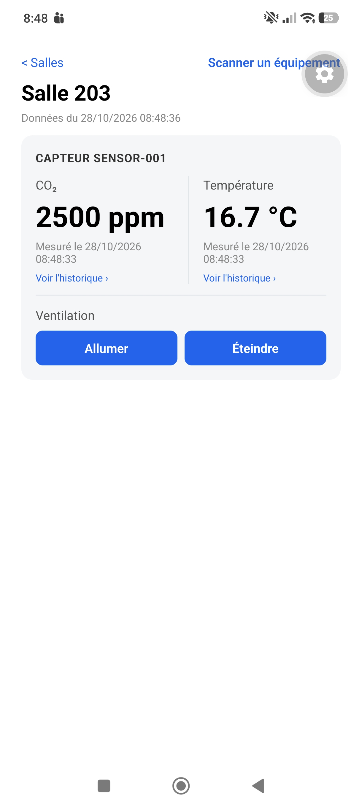
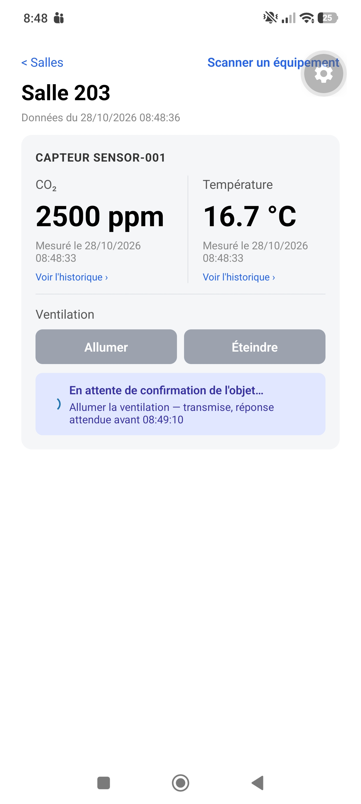
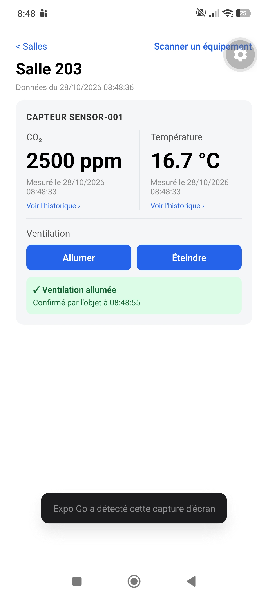

# Journal - Jour 4

## Objectifs du jour

Commander un objet depuis le téléphone et confirmer l'exécution : distinguer
la demande envoyée de l'action réellement exécutée par l'objet. Contrat de
commande et d'ACK, cycle de vie persisté (`PENDING`, `SENT`, `ACKNOWLEDGED`,
`FAILED`, `TIMEOUT`), timeout, idempotence, suivi d'un `commandId` de bout en
bout dans les logs, affichage honnête côté mobile, et trois anomalies au
minimum provoquées et prouvées.

Toutes les décisions de la journée sont regroupées dans
[ADR 0014 — Commandes : contrat, cycle de vie, timeouts et idempotence](decisions/0014-cycle-de-vie-des-commandes.md).

## Questions à résoudre

### Quelle différence entre une commande acceptée par le backend, publiée sur MQTT, reçue par l'objet et réellement exécutée ?

Ce sont quatre faits distincts, établis par quatre acteurs différents, et
le backend n'en observe directement que deux :

| Étape | Qui le sait | Comment | État de la commande |
|---|---|---|---|
| **Acceptée** | backend | demande valide (type de commande sur liste blanche, paramètres bornés), persistée | `PENDING` |
| **Publiée** | backend + broker | le broker MQTT a accusé réception de la publication (PUBACK, QoS 1) | `SENT` |
| **Reçue par l'objet** | l'objet seul | rien ne le prouve au backend tant que l'objet ne répond pas | reste `SENT` |
| **Exécutée** | l'objet seul | l'objet l'affirme dans son ACK, émis **après** exécution, avec son état résultant | `ACKNOWLEDGED` |

Points clés :

- `SENT` ne veut **pas** dire « reçue par l'objet ». Le broker a accepté de
  la transmettre, rien de plus. Un objet éteint laisse la commande en
  `SENT` jusqu'au timeout (preuve n°2 ci-dessous).
- L'ACK n'est émis qu'après exécution et porte un statut (`executed`,
  `rejected`, `expired`) et l'état réel (`state`). `executed` veut donc
  dire « c'est fait », pas « je l'ai reçue ». Un double ACK
  (« reçue » puis « exécutée ») a été écarté : il double les cas
  d'incertitude pour un gain faible sur une action quasi instantanée.
- La publication peut elle-même être incertaine. Le publisher renvoie
  `confirmed`, `not_sent` (client MQTT déconnecté : rien n'est parti, la
  commande passe en `FAILED`, `broker_unavailable`) ou `unconfirmed` (pas de
  PUBACK sous 5 s : la commande a pu partir, elle reste `PENDING`). On ne
  conclut que sur une certitude.
- `POST /devices/:id/commands` répond **`202 Accepted`** (et non `201`) :
  la demande est acceptée, son exécution n'est pas confirmée.

### Comment rattacher la réponse de l'objet à la bonne commande ?

Par **corrélation sur le `command_id`** : le backend génère un UUID à la
persistance, l'envoie dans la commande, et l'objet le **recopie** dans son
ACK.

```
backend → objet   campus/v1/devices/{deviceId}/commands
{ "schema_version": 1, "command_id": "8f1c…", "device_id": "sensor-001",
  "type": "set_ventilation", "params": { "on": true },
  "created_at": "…T10:00:00.000Z", "expires_at": "…T10:00:15.000Z" }

objet → backend   campus/v1/devices/{deviceId}/commands/ack
{ "schema_version": 1, "command_id": "8f1c…", "status": "executed",
  "reason": null, "state": { "ventilation": "on" }, "acked_at": "…T10:00:01.200Z" }
```

Deux garde-fous :

- **Le topic fait foi** (comme pour la télémétrie, ADR 0008). Le
  `deviceId` est lu dans le topic de l'ACK et comparé à celui de la
  commande. Un ACK publié sur le topic d'un autre objet est rejeté
  (`device_mismatch`) : connaître un `command_id` ne suffit pas pour
  acquitter la commande d'un autre. L'ACL du broker restreint en plus
  chaque objet à **ses** commandes et **ses** ACK.
- **Transitions atomiques** : chaque changement d'état est un
  `UPDATE … WHERE id = ? AND status IN (états de départ autorisés)`. L'API,
  l'ingester (ACK) et le worker (timeout) sont trois process distincts qui
  peuvent viser la même commande au même instant : un seul gagne, les
  autres le constatent. La course a été observée en réel : dans la preuve
  n°1, l'ACK de l'objet arrive **avant** que l'API ait journalisé la
  confirmation du broker.

### Que doit faire le système si l'objet est hors ligne, si l'ACK est perdu ou s'il arrive après le timeout ?

- **Objet hors ligne ou silencieux, ACK perdu** : pas d'ACK avant
  `expires_at` (création + 15 s) + 5 s de marge, et le **worker** passe la
  commande en **`TIMEOUT`** (balayage toutes les 2 s, état en base, donc
  aucune échéance perdue au redémarrage). `TIMEOUT` ne veut **pas** dire
  « échec » : l'état réel de l'objet est **inconnu**. La preuve n°4 le
  montre : ACK perdu, `TIMEOUT`, alors que la ventilation **a** été
  allumée (le CO2 chute).
- **ACK arrivé après le timeout** : la commande **reste `TIMEOUT`** (c'est
  ce que l'utilisateur a vu ; deux lectures successives ne doivent pas se
  contredire), mais l'ACK n'est **pas ignoré**. Son statut et l'heure
  d'exécution déclarée par l'objet sont conservés (`lateAck`, exposé par
  l'API) avec l'état rapporté, et journalisés (`reason: late_ack`). Le
  mobile affiche « L'objet a finalement répondu après le délai : commande
  exécutée à … ». Écarté : repasser en `ACKNOWLEDGED`, car l'état final
  changerait après coup.
- **Commande livrée en retard à l'objet** (objet coupé puis rallumé, avec
  une session MQTT persistante) : le champ `expires_at` empêche l'objet
  d'exécuter une commande que le backend a déjà abandonnée. Il répond
  `expired` **sans rien exécuter** (preuve n°8).

### Que se passe-t-il si la même commande est reçue deux fois ?

Un doublon peut apparaître à trois endroits, chacun avec sa parade :

1. **Le mobile envoie deux fois la même demande** (double appui, réponse
   perdue puis nouvel essai) : en-tête **`Idempotency-Key` obligatoire**, un
   par intention de l'utilisateur, réutilisé pour les nouveaux essais.
   Une contrainte unique `(requestedBy, idempotencyKey)` en base garantit
   qu'**une seule commande** est créée. Le rejeu renvoie `200` +
   `Idempotent-Replayed: true` avec l'état courant. La même clé pour une
   autre commande donne `409` (preuve n°7). Sans clé, `400` (testé dans
   `test/driving/api/server.test.ts`).
2. **L'objet reçoit deux fois la même commande** (redélivrance QoS 1) : il
   garde en mémoire les `command_id` traités. Sur un doublon, il **n'exécute
   pas une seconde fois** mais **renvoie le même ACK** (c'est peut-être lui
   qui s'était perdu). Sa mémoire est bornée par `expires_at` (preuve n°6).
3. **Le backend reçoit deux fois le même ACK** : le premier fait foi, le
   second est sans effet (`duplicate_ack`).

Filet de dernier recours : toutes les commandes fixent un **état cible**
(`set_ventilation { on: true }`), jamais une variation (`toggle`,
`+1 °C`). Une commande absolue exécutée deux fois laisse le même état,
une variation s'annulerait ou se cumulerait silencieusement.

## Travail de l'équipe

- **Maxence Ouvrard** :
  - **Backend** : contrat de commande et d'ACK (topics `v1`, payloads,
    liste blanche dans le domaine), cycle de vie à 5 états avec
    transitions atomiques, timeout dans le worker, ACK tardif, idempotence
    (`Idempotency-Key`), 3 migrations Prisma, ACL mosquitto.
  - **Simulateur d'objet** : réception des commandes, exécution, ACK,
    déduplication par `command_id`, effet de la ventilation sur le CO2,
    options pour provoquer les anomalies.
- **Ethan Tillier** :
  - **Logs de bout en bout** : un champ `service` par process, Promtail
    étendu à tous les services (corrige aussi les panneaux J3, qui ne
    voyaient plus les mesures depuis le worker), dashboard Grafana
    « Commandes (J4) », script `trace:command`.
  - **Mobile** : bloc « Ventilation », suivi de l'état, textes par état,
    nouvel essai réseau avec la même clé.
  - **Preuves** : les 8 scénarios ci-dessous, ADR 0014.

## Jalons de fin de journée

Les preuves sont produites sur la stack Docker locale (`docker compose up -d`
+ simulateur en conteneur) avec `npm run trace:command -- <commandId>`
(Loki + base vérifiée). Ce script reconstruit la timeline, coche les
étapes attendues et désigne la première manquante. Sorties complètes dans
[`docs/preuves/j4/`](preuves/j4/). Heures en UTC.

Reproduire une commande depuis la ligne de commande :

```bash
cd backend
docker compose up -d --build && npx tsx prisma/seed.ts
docker compose --profile simulator up -d --build simulator     # objet sensor-001, mode normal
TOKEN=$(curl -s -X POST localhost:3010/auth/login -H 'content-type: application/json' \
  -d '{"email":"operateur@campify.local","password":"campify-operateur"}' | sed -E 's/.*"token":"([^"]+)".*/\1/')
curl -s -X POST localhost:3010/devices/sensor-001/commands -H "authorization: Bearer $TOKEN" \
  -H 'content-type: application/json' -H "idempotency-key: $(uuidgen)" \
  -d '{"type":"set_ventilation","params":{"on":true}}'
npm run trace:command -- <id renvoyé>
```

(port `3010` : celui de `docker-compose.override.yml` ; `3000` sans override.)

- [x] **Une commande initiée depuis le téléphone atteint l'objet via le backend et MQTT.**
- [x] **L'objet renvoie un ACK contenant le `commandId` et le backend rattache ce retour à la bonne commande.**

  Preuve n°1, flux nominal ([01-flux-nominal.txt](preuves/j4/01-flux-nominal.txt)) :

  ```
  06:52:44.531  campify-api       command request received          received      idempotencyKey=demo-nominal-1
  06:52:44.555  campify-api       command accepted                  PENDING       idempotencyKey=demo-nominal-1
  06:52:44.561  device-simulator  command received                  received
  06:52:44.569  device-simulator  command executed                  executed
  06:52:44.572  device-simulator  ack sent                          ack_sent      ackStatus=executed
  06:52:44.575  campify-ingester  command ack received              ack_received  ackStatus=executed
  06:52:44.576  campify-api       command published                 SENT          transitionApplied=true
  06:52:44.779  campify-ingester  command acknowledged by device    ACKNOWLEDGED  latencyMs=237
  → Parcours complet.   État en base : ACKNOWLEDGED, reportedState { ventilation: "on" }
  ```

  Le même `commandId` traverse les quatre process (API, objet, ingester).
  L'ACK est rattaché par `command_id` **et** vérifié contre le topic
  (`device_mismatch` sinon, testé dans
  `test/driving/mqtt/handlers.test.ts`).

  Preuve n°9, **même flux initié depuis le téléphone** (Expo Go sur
  Android, Salle 203 / `sensor-001`, compte `operateur@campify.local`,
  bouton « Allumer » du bloc Ventilation), le 2026-10-28
  ([09-flux-depuis-le-telephone.txt](preuves/j4/09-flux-depuis-le-telephone.txt)) :

  | Avant l'appui | En attente de l'ACK | Confirmé par l'objet |
  |---|---|---|
  |  |  |  |

  ```
  07:48:55.199  campify-api       command request received          received      idempotencyKey=1b2ca827-…
  07:48:55.231  campify-api       command accepted                  PENDING
  07:48:55.241  device-simulator  command received                  received
  07:48:55.258  campify-api       command published                 SENT          transitionApplied=true
  07:48:55.258  device-simulator  command executed                  executed
  07:48:55.264  device-simulator  ack sent                          ack_sent      ackStatus=executed
  07:48:55.277  campify-ingester  command ack received              ack_received  ackStatus=executed
  07:48:55.564  campify-ingester  command acknowledged by device    ACKNOWLEDGED  latencyMs=349
  → Parcours complet.   commandId 8968f1c4-f21a-456c-9cb4-6c1148b3df24
  État en base : ACKNOWLEDGED, reportedState { ventilation: "on" }
  ```

  L'`idempotencyKey` est générée par l'app : c'est bien la demande du
  téléphone qui traverse API → MQTT → objet → ACK → ingester. Pendant
  l'attente, les boutons sont désactivés et l'écran indique l'échéance
  (« réponse attendue avant 08:49:10 », soit `expires_at` en heure locale
  UTC+1). Le message « ✓ Ventilation allumée — Confirmé par l'objet à
  08:48:55 » n'apparaît qu'après l'ACK, et l'état affiché est celui que
  l'objet a rapporté.

- [x] **Le mobile distingue clairement une commande en attente, confirmée, échouée ou expirée.**

  `mobile/src/utils/commandStatus.ts`. Rien n'est présenté comme réussi
  avant l'ACK, et l'état confirmé est celui **rapporté par l'objet**, pas
  celui demandé :

  | État | Affichage |
  |---|---|
  | `PENDING` / `SENT` | « Demande enregistrée… » / « En attente de confirmation de l'objet… » (indicateur de chargement, boutons désactivés) |
  | `ACKNOWLEDGED` | « ✓ Ventilation allumée — Confirmé par l'objet à … » |
  | `FAILED` | « ✗ … : échec », avec la raison (objet a refusé / rien n'a été envoyé / reçue trop tard) |
  | `TIMEOUT` | « ⚠ Pas de confirmation de l'objet — l'état réel est inconnu » (jamais « échec »), puis l'ACK tardif s'il arrive |

  Preuve reproductible : `cd mobile && npx jest` → **43/43**, dont
  `DeviceCommandPanel.test.tsx` (« affiche l'attente puis le résultat
  confirmé par l'ACK — jamais "allumée" avant », TIMEOUT sans le mot
  « échec », raisons de FAILED, nouvel essai réseau **avec la même clé**)
  et `commandStatus.test.ts`.

- [x] **Une absence d'ACK déclenche un timeout reproductible.**

  Trois scénarios sans ACK, trois `TIMEOUT` déclarés par le worker entre
  **20,1 s et 21,5 s** après la création (15 s de délai, 5 s de marge,
  ≤ 2 s de balayage) :

  ```
  idempotencyKey | status  |    délai
  j4-offline-1   | TIMEOUT | 00:00:20.437
  j4-silent-1    | TIMEOUT | 00:00:20.07
  j4-dropack-1   | TIMEOUT | 00:00:21.49
  ```

  Testé aussi unitairement (`test/domain/services/commandTimeoutService.test.ts`,
  y compris la course ACK contre timeout).

- [x] **À partir d'un `commandId`, les logs permettent de reconstruire le parcours réel de la commande et d'identifier l'étape en échec.**

  Voir les anomalies ci-dessous : pour chacune, `trace:command` désigne
  l'étape exacte où la chaîne s'est interrompue. Même chose dans Grafana
  (http://localhost:3001), dashboard « Campify — Commandes (J4) », champ
  `commandId`.

- [x] **Une commande rejouée ne provoque pas silencieusement une double exécution.**

  Preuves n°6 (côté objet) et n°7 (côté API) ci-dessous.

- [x] **L'équipe peut expliquer ce que le système sait réellement à chaque étape du cycle de vie d'une commande.**

  Tableau de la première question, et tableau « ce que le backend sait /
  ne sait pas » de l'[ADR 0014](decisions/0014-cycle-de-vie-des-commandes.md#états).

### Anomalies provoquées et preuves

Chaque anomalie est provoquée avec une option du simulateur
(`docker compose run --rm simulator --devices <id> --qos 1 <option>`, voir
`npm run simulate:devices -- --help`).

**n°2 — Objet hors ligne** (aucun simulateur pour `sensor-003`) —
[02-objet-hors-ligne.txt](preuves/j4/02-objet-hors-ligne.txt)

```
07:17:35.550  campify-api     command request received   received
07:17:35.571  campify-api     command accepted           PENDING
07:17:35.584  campify-api     command published          SENT
07:17:56.008  campify-worker  command timed out          TIMEOUT reason=no_ack
→ Chaîne interrompue à l'étape : « Reçue par l'objet »
```

La chaîne s'arrête **entre le broker et l'objet** : le broker a accepté
la commande (`SENT`), mais aucun objet ne l'a lue. Le backend ne voit
qu'une absence de réponse, d'où `TIMEOUT` et un état réel inconnu.

**n°3 — Objet silencieux** (`--command-mode silent`, `sensor-002`) —
[03-objet-silencieux.txt](preuves/j4/03-objet-silencieux.txt)

```
07:17:35.931  campify-api       command accepted                             PENDING
07:17:35.934  device-simulator  command received                             received
07:17:35.938  device-simulator  command received but ignored (silent mode)   ignored
07:17:35.940  campify-api       command published                            SENT
07:17:56.014  campify-worker    command timed out                            TIMEOUT reason=no_ack
→ Chaîne interrompue à l'étape : « Exécutée par l'objet »
```

**Même statut backend que le n°2** (`SENT` puis `TIMEOUT`, `no_ack`),
mais la chaîne diverge plus loin : la commande **est arrivée**, et l'objet
ne l'a pas traitée. Seuls les logs côté objet permettent de distinguer
les deux cas. C'est l'argument pour suivre le `commandId` jusque dans
l'objet.

**n°4 — ACK perdu** (`--drop-ack`, `sensor-001`) —
[04-ack-perdu.txt](preuves/j4/04-ack-perdu.txt)

```
07:17:36.535  device-simulator  command received               received
07:17:36.541  campify-api       command published              SENT
07:17:36.544  device-simulator  command executed               executed
07:17:36.545  device-simulator  ack dropped (simulated loss)   ack_dropped
07:17:58.025  campify-worker    command timed out              TIMEOUT reason=no_ack
→ Chaîne interrompue à l'étape : « ACK émis par l'objet »
```

Preuve indépendante que l'action **a eu lieu** : le CO2 mesuré par
`sensor-001` (base vérifiée) chute dès l'exécution.

```
07:17:33  740 ppm   07:17:37  672 ppm   07:17:41  547 ppm   07:17:45  428 ppm
07:17:35  746 ppm   07:17:39  618 ppm   07:17:43  471 ppm   07:17:47  400 ppm
```

C'est l'incertitude réelle d'un système distribué : le backend affiche
`TIMEOUT` alors que la ventilation tourne. C'est pourquoi `TIMEOUT` n'est
jamais présenté comme un échec, ni dans l'API ni sur le mobile.

**n°5 — ACK tardif** (`--ack-delay 25000`, `sensor-001`) —
[05-ack-tardif.txt](preuves/j4/05-ack-tardif.txt)

```
07:18:50.961  device-simulator  command executed           executed
07:18:50.962  device-simulator  ack delayed (simulated)    ack_delayed
07:19:12.194  campify-worker    command timed out          TIMEOUT reason=no_ack
07:19:15.965  campify-ingester  command ack received       ack_received ackStatus=executed
07:19:15.985  campify-ingester  late ack after timeout     TIMEOUT reason=late_ack
→ « État mis à jour par l'ACK » non atteint, à la place : late_ack
État en base : TIMEOUT, lateAckStatus=executed, lateAckAt=07:18:50.961, reportedState { ventilation: "on" }
```

L'ACK arrive 3,8 s après le `TIMEOUT`. Le comportement documenté
s'applique : le statut **reste** `TIMEOUT`, l'ACK tardif est conservé et
exposé (`lateAck`), et l'heure d'exécution déclarée par l'objet est
antérieure au timeout.

**n°6 — Commande reçue deux fois par l'objet** (`--redeliver`, `sensor-002`) —
[06-commande-recue-deux-fois.txt](preuves/j4/06-commande-recue-deux-fois.txt)

```
07:18:51.321  device-simulator  command executed                                    executed      delivery=first
07:18:51.326  device-simulator  ack sent                                            ack_sent
07:18:51.385  campify-ingester  command acknowledged by device                      ACKNOWLEDGED  latencyMs=74
07:18:52.325  device-simulator  command redelivered (simulated)                     received      delivery=redelivery
07:18:52.326  device-simulator  command already processed: not executed again,
                                same ack re-sent                                    duplicate     reason=duplicate_command
07:18:52.330  device-simulator  ack sent                                            ack_sent      delivery=redelivery
07:18:52.348  campify-ingester  duplicate ack ignored                               ACKNOWLEDGED  reason=duplicate_ack
```

**Une seule exécution** malgré deux réceptions. L'objet renvoie le même
ACK, et le backend l'ignore car la commande est déjà conclue.

**n°7 — Requête API dupliquée** (même `Idempotency-Key` envoyée trois
fois, `sensor-003`) — [07-requete-api-dupliquee.txt](preuves/j4/07-requete-api-dupliquee.txt)

```
1er envoi                    → HTTP 202 Accepted   status SENT
2e envoi (même clé)          → HTTP 200 OK + idempotent-replayed: true, même id, status ACKNOWLEDGED
3e envoi (même clé, on:false) → HTTP 409 Conflict
Commandes en base pour cette clé : 1
```

```
07:18:51.823  device-simulator  command received                                       received
07:18:51.850  campify-ingester  command acknowledged by device                         ACKNOWLEDGED
07:18:52.271  campify-api       duplicate command request, existing command returned   reason=duplicate_request
07:18:52.674  campify-api       command request rejected                               reason=idempotency_key_conflict
```

Une seule ligne `command received` côté objet : la commande n'a été
publiée qu'une fois.

**n°8 (bonus) — Livraison tardive après coupure** (`--persistent-session`,
objet coupé pendant l'envoi puis rallumé après le timeout) —
[08-livraison-tardive-expiree.txt](preuves/j4/08-livraison-tardive-expiree.txt)

```
07:20:57.786  campify-api       command published         SENT
07:21:18.457  campify-worker    command timed out         TIMEOUT reason=no_ack
07:21:22.291  device-simulator  command received          received        (objet rallumé, file du broker)
07:21:22.295  device-simulator  command expired           expired reason=received_after_expires_at
07:21:22.315  campify-ingester  late ack after timeout    TIMEOUT reason=late_ack ackStatus=expired
→ « Exécutée par l'objet » non atteinte, à la place : expired
```

Sans `expires_at`, la ventilation se serait allumée 25 s après que
l'utilisateur a vu « pas de confirmation », sans que personne ne l'attende.
L'objet constate que la commande est périmée et ne l'exécute pas.

### Résultats obtenus en exécutant ces preuves (2026-10-08)

- Backend : `npm test` → **149/150 passent, 0 échec** (1 ignoré, comme
  avant J4), y compris les tests d'intégration Prisma sur la base Docker et
  les 3 migrations J4 appliquées par `prisma migrate deploy`.
- Mobile : `npx jest` → **43/43**.
- Les 8 scénarios ci-dessus ont été exécutés sur la stack réelle (API,
  ingester, worker, mosquitto, PostgreSQL, Loki, simulateur en conteneur).
- Preuve n°9 (2026-10-28) : flux complet rejoué depuis un téléphone
  Android réel (Expo Go), sur la même stack.

## Livrables de fin de J4

- **Tag Git `J4`** : posé sur l'état présenté.
- **`docs/J4.md`** : ce document.
- **Preuve du flux complet** mobile → backend → MQTT → objet → ACK →
  backend → mobile : preuve n°9 (captures du téléphone + trace du même
  `commandId`), complétée par la preuve n°1 et les tests mobiles.
- **Preuves du timeout, de l'ACK tardif ou perdu et de la commande
  dupliquée** : n°2 à n°8, sorties complètes dans
  [`docs/preuves/j4/`](preuves/j4/).
- **`docs/architecture.md`** : mis à jour : section « Flux montants et
  descendants » (topics de commande et d'ACK, diagramme de séquence),
  schéma général corrigé.
- **Décision documentée** :
  [ADR 0014](decisions/0014-cycle-de-vie-des-commandes.md) (contrat, cycle
  de vie, timeout, ACK tardif, idempotence, affichage mobile, alternatives
  écartées). ADR 0004 mis à jour (contrat de commande défini par l'équipe).

## État réel du projet

- **Fonctionne et est prouvé en local** : chaîne complète de commande avec
  le simulateur, cycle de vie à 5 états, timeout, ACK tardif, idempotence
  à trois niveaux, traçabilité par `commandId`.
- **Non vérifié contre le kit réel** : le contrat de commande et d'ACK est
  défini par l'équipe. Aucune commande n'a été publiée vers le broker
  partagé du kit, puisque ce serait une écriture sur un système partagé
  (ADR 0004). Un écart ne toucherait que `shared/mqttTopics.ts`,
  `driving/mqtt/schemas.ts` et `infra/mqtt/MqttCommandPublisher.ts`.
- **Limites connues** :
  - le mobile suit l'état par polling (pas de notification si l'app est
    fermée pendant l'attente, pas d'historique des commandes dans l'app) ;
  - `expires_at` suppose des horloges objet/backend synchronisées (NTP) ;
  - l'état courant de l'objet n'est connu que via le dernier ACK (le topic
    `…/state` du kit n'est pas encore consommé).
- **Mobile** : validé par les tests Jest (43/43) et sur un téléphone Android
  réel via Expo Go (preuve n°9, `EXPO_PUBLIC_API_URL=http://<IP du PC>:3010`).
